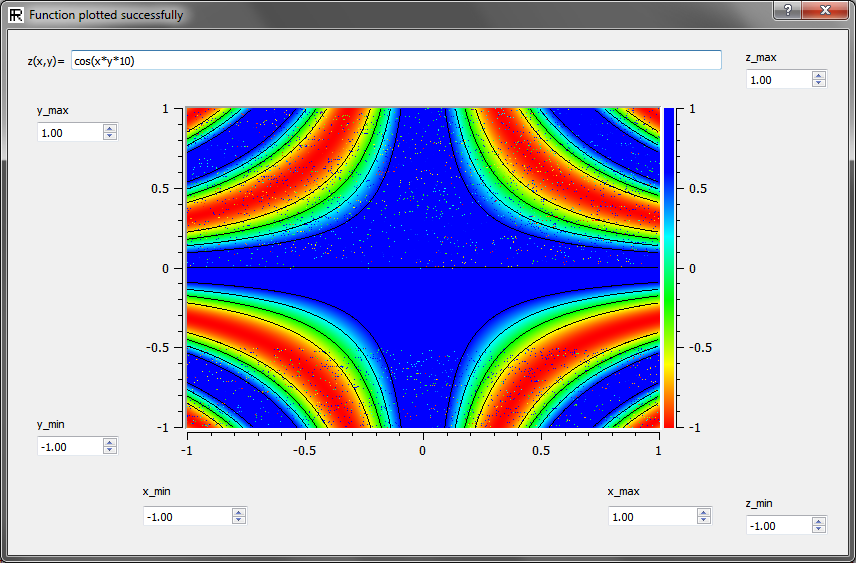

# SurfacePlotter

Plots a user-defined two-dimensional function.

SurfacePlotter is one of [Richèl Bilderbeek's tools](https://richelbilderbeek.github.io/tools/).

## Links

- [Source code](https://github.com/richelbilderbeek/SurfacePlotter)
- [Richèl Bilderbeek's tools](https://richelbilderbeek.github.io/tools/)
